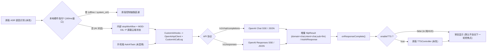

# 雷鸟 AI (RayNeo AI) 自定义 LLM 接口改造说明与升级指南

> 适用设备：**雷鸟 io** 智能眼镜 + **小米 17 Ultra (`25128PNA1C`)**  
> 基准官方版本：`com.rayneo.venus.pub` v1.0.20 (`versionCode=309`)  
> 改造产物：[RayNeo_AI_1.0.20_CustomAI.apk](./RayNeo_AI_1.0.20_CustomAI.apk)

---

## 一、改造原则（最小侵入 + 保留原版 ASR / TTS）

本次改造采用 **Option 1（`com.rayneo.airuntime` 未混淆桥接层拦截）**，严格遵守「**只替换大模型 LLM 推理，原版语音识别与语音播报全部不动**」：

- **保留原版 ASR**：继续使用雷鸟原生高精度 ASR 语音识别与离线唤醒。
- **系统级第三方音乐播控与实时曲目抓取（`SystemMediaBridge`）**：针对雷鸟 io 官方 RayClaw 不支持操控手机第三方音乐软件的问题，直接复用雷鸟 App 已获授权的 `NotificationsHandlerService` 通知监听权限调用系统 `MediaSessionManager.getActiveSessions()`（辅以 `AudioManager` 媒体键兜底），支持网易云音乐、QQ音乐、汽水音乐、Apple Music、Spotify、B站等全平台 **`切歌/下一首`、`上一首`、`暂停播放`、`继续播放`、`收藏这首歌`、`查询当前正在播放什么歌`**，切歌后自动轮询读取新歌名/歌手/专辑并播报，且向自定义 LLM 动态注入当前正在播放的曲目上下文。
- **三层官方技能与联网实时工具精准分流（`passThroughOfficialSkills`，默认开启）**：天气（`get_weather`）、待办/提醒/日程创建（`create_todo` 等）、系统硬件控制、电话、导航、识图与记忆全部无缝直通官方原版链路。
- **彻底隔离并行 C++ 云端工作流（修复 3~4 字断流问题）**：当自定义 LLM 触发后，立即内部调用 `ctrl.stopWorkflow(aiConfig)` 停止 C++ 通义云端流程（消除云端 TTS/超时竞争），同时通过 `MOD-03L~Q` 过滤 `SpeechStatus` / `VadStatus` / `AudioRecordStart` / 重复 `AudioRecordEnd` / `Notify` 并在手动或自动下一轮时由 `startNextRound()` 无缝重启会话。
- **保留原版 TTS**：当 `enableTTS=false`（雷鸟 io 无扬声器纯显示模式）时不触发语音播报；当开启语音播报（`enableTTS=true`）时，直接复用原版 `AiRuntimeNative.getTtsController()` 与官方音色完成播报。
- **调用审计与可观测性（`CustomAiCallLog`）**：持久化保存最近 30 次调用记录，含调用渠道（`👓 眼镜语音` / `📱 手机 AskAI` / `🔌 连通性测试`）、实际请求端点 URL、模型名、提问文本、完整返回内容、首字/总耗时（ms）与生命周期事件时间线；悬浮按钮同步实时展示 `⚡请求中…` / `⚡输出中…` / `⚡播报中…`。
- **与官方主题解耦的自绘深色 UI（修复 HyperOS 开关不显示）**：`CustomAiSettingsDialog` 不使用依赖 `FlutterActivity` 旧主题的系统 `Switch` / `CheckBox` / `RadioButton` / `Spinner` / `AlertDialog`，全部改用纯 `Dialog` + `GradientDrawable` 圆角卡片、自定义胶囊拨动开关（`ToggleRow`）与分段选择器（`SegmentSelector`）。
- **新增代码独立隔离**：全部自定义 UI、调用日志、网络客户端与会话记忆均封装在新增的 `classes8.dex`（`com.rayneo.customai.*`），对官方原包仅修改 **4 个未混淆类** 的注入点，并全部使用 `# ==================== [RAYNEO_CUSTOM_AI_MOD START/END : MOD-0X] ====================` 标注。

### 数据流架构图



---

## 二、修改清单与代码标注位置（`MOD-01` ~ `MOD-05`）

全部修改的原始文件、打补丁后文件与 unified diff 均已存档于 [custom_ai_mod/annotations](./custom_ai_mod/annotations)：

| 编号 | 目标类 (原始包路径) | 修改方法与作用 | Diff 文件 |
| :--- | :--- | :--- | :--- |
| **MOD-01** | `com.rayneo.venus.VenusApplication` | `onCreate()` 初始化自定义配置、歌词提词器桥接引擎与 AskAI 传输模式开关 | [MOD-01_VenusApplication.diff](./custom_ai_mod/annotations/diffs/MOD-01_VenusApplication.diff) |
| **MOD-02A** | `com.rayneo.venus.MainActivity` | `dispatchKeyEvent()` 监听 **连按 3 次音量+** 打开设置面板 | [MOD-02_MainActivity.diff](./custom_ai_mod/annotations/diffs/MOD-02_MainActivity.diff) |
| **MOD-02B** | `com.rayneo.venus.MainActivity` | `onResume()` 在应用内挂载可拖拽 `⚡LLM` 悬浮球（支持实时状态显示） | [MOD-02_MainActivity.diff](./custom_ai_mod/annotations/diffs/MOD-02_MainActivity.diff) |
| **MOD-03A~D** | `com.rayneo.airuntime.controller.AssistantController` | `initWorkflow` / `startWorkflow` / `stopWorkflow` / `destroyWorkflow` 会话生命周期接管与内部停流豁免 | [MOD-03_AssistantController.diff](./custom_ai_mod/annotations/diffs/MOD-03_AssistantController.diff) |
| **MOD-03E** | `com.rayneo.airuntime.controller.AssistantController` | `nativeOnAsrResult()` 触发自定义 LLM、语音点歌与歌词提词联动（使用 `invoke-static/range` 兼容高寄存器） | [MOD-03_AssistantController.diff](./custom_ai_mod/annotations/diffs/MOD-03_AssistantController.diff) |
| **MOD-03F~G, I~K** | `com.rayneo.airuntime.controller.AssistantController` | `nativeOnNlpResult` / `DeepThink` / `TtsStatus` / `ResponseComplete` / `Error` 按会话归属分流：官方技能直通时完整放行并记录审计，自定义对话时抑制云端残留 | [MOD-03_AssistantController.diff](./custom_ai_mod/annotations/diffs/MOD-03_AssistantController.diff) |
| **MOD-03H** | `com.rayneo.airuntime.controller.AssistantController` | `nativeOnRayClawToolCallInfo()` 实时捕获 RayClaw 服务端/客户端工具调用（天气、联网搜索、待办/提醒/日程创建、切歌/音乐、导航、随身记忆等），立即切换至官方原版引擎完整放行 | [MOD-03_AssistantController.diff](./custom_ai_mod/annotations/diffs/MOD-03_AssistantController.diff) |
| **MOD-03L~P** | `com.rayneo.airuntime.controller.AssistantController` | `nativeOnSpeechStatus` / `VadStatusChange` / `AudioRecordStart` / 重复 `AudioRecordEnd` / `Notify` 过滤，防止眼镜显示 3~4 字后被云端状态关闭或覆盖 | [MOD-03_AssistantController.diff](./custom_ai_mod/annotations/diffs/MOD-03_AssistantController.diff) |
| **MOD-03Q** | `com.rayneo.airuntime.controller.AssistantController` | `startNextRound()` 扩容 `.registers 1 -> 2`，在 C++ 已停流时自动重新拉起 `startWorkflow()` | [MOD-03_AssistantController.diff](./custom_ai_mod/annotations/diffs/MOD-03_AssistantController.diff) |
| **MOD-04A~D** | `com.rayneo.airuntime.controller.AskAITask` | `initTask` / `startTask` / `stopTask` / `releaseTask` 接管手机端 Ask AI 对话 | [MOD-04_AskAITask.diff](./custom_ai_mod/annotations/diffs/MOD-04_AskAITask.diff) |
| **MOD-05** | `com.rayneo.rayneo_venus_sdk_plugin.o4` | `F(String, Map)` 旁路监听 `RayneoNet` 蓝牙事件（`TELEPROMPTER` 握手应答 / 镜腿退出、`fileShareSuccess`、蓝牙重连），配合 `w.t(v0)` 实现音乐 `.lrc` 歌词与眼镜提词器毫秒级滚动同步 | [MOD-05_RayneoNetBridge_o4.diff](./custom_ai_mod/annotations/diffs/MOD-05_RayneoNetBridge_o4.diff) |

汇总差异文件：[ALL_MODIFICATIONS.diff](./custom_ai_mod/annotations/diffs/ALL_MODIFICATIONS.diff)

---

## 三、小米 17 Ultra 安装、覆盖更新与配置使用指南

1. **首次安装与后续更新（直接覆盖安装，无需卸载）**：
   - 包名保持官方 `com.rayneo.venus.pub`，签名固定使用项目内置密钥库 [rayneo_custom_ai.jks](./custom_ai_mod/keys/rayneo_custom_ai.jks)。
   - **重要**：一旦手机上已安装本项目的自定义版本，后续每次更新均**直接覆盖安装**即可（切勿卸载），原有登录状态、**雷鸟 io 蓝牙配对**、API Key 与调用历史全部完整保留。
   - 若通过手机「文件管理 -> 下载 (Download)」点击 `RayNeo_AI_1.0.20_CustomAI.apk` 安装并弹出小米「安全守护」提示，选择「继续安装 / 了解风险仍安装」完成覆盖更新即可。
2. **打开自定义 API 配置面板与调用历史（两种方式）**：
   - **方式 A**：点击手机端雷鸟 App 右侧/边缘的可拖拽悬浮按钮（空闲显示 `⚡LLM` / `⚡Resp`，调用中实时显示 `⚡请求中…` / `⚡输出中…` / `⚡播报中…`）。
   - **方式 B**：在 App 主界面 **1.5 秒内连按 3 次手机「音量 +」键**。
   - 点击面板顶部的 **「📜 查看调用历史与返回结果」** 或最近一次摘要卡片，即可核对每一笔调用是否命中自定义 URL、模型与完整返回正文及毫秒级事件时间线。
3. **API 参数填写说明**：
   - **协议支持**：可在分段选择器中选择 **`/chat/completions`** 或 **`/responses`**。
   - **快捷预设**：支持一键填充 `OpenAI Chat`、`OpenAI Resp`、`DeepSeek`、`SiliconFlow`、`阿里百炼兼容` 示例参数。
   - **开关行为**：
     - 「播报完自动开启下一轮拾音」默认**关闭**，以防回答刚展示在眼镜屏幕就被新一轮收音清屏。
     - 「调用时弹出 Toast 提示」默认**开启**，方便即时确认请求已切入自定义 API。
   - **Base URL 注意事项**：由于官方 `AndroidManifest.xml` 默认遵循 Android 9+ 安全策略（禁止明文 `http://` 流量），填写服务端地址时**请使用 `https://` 域名**。
   - **推理模型（`/v1/responses` + `Reasoning Effort`）**：开启 `Low`/`Medium`/`High` 思考强度时，客户端会自动按 OpenAI Responses 规范省略 `temperature` 并附带 `"reasoning": {"effort": ..., "summary": "auto"}`。
   - **连接测试与导出**：点击 **「🔌 发送测试请求」** 可实时查看耗时（ms）、模型回显并写入调用历史；支持通过剪贴板 **「📋 导出配置」 / 「📥 导入配置」**。

---

## 三点五、三层官方技能与联网实时工具精准分流（`passThroughOfficialSkills`，默认开启）

在雷鸟 io（`LinkType.RAYCLAW`）模式下，官方技能与实时信息由三类真实接口协同完成：
- **蓝牙 BLE `0x20` (`SkillPayloadTransportPayload`) + 离线 `sherpa_skills.json`**：切歌/上曲/暂停/播放、音量/亮度/电量、拍照/录像/录音、电话接挂、提醒/倒计时下发眼镜硬件；
- **手机端 Flutter `onIntentRaised` + 待办/日历服务（`ai_task_service` / `rayneo_tasks_adapter` / `system_reminders_adapter` / `calendar_write_router`）**：真实写入雷鸟 App 待办事项、系统提醒与日历日程；
- **RayClaw 云端工具调用（`nativeOnRayClawToolCallInfo`）**：联网查天气、实时搜索、云端待办同步、记忆检索等，完成后通过 `NlpResult(domain="chat", sub="rayclaw")` 与原生 TTS 播报结果。

为此 `CustomAiHooks` 采用 **三层零误杀分流架构**：

1. **第零层（`SystemMediaBridge` 原生系统媒体播控 & 曲目抓取）**：
   - 识别到 `切歌/下一首`、`上一首`、`暂停播放`、`继续播放`、`收藏这首歌`、`现在放的是什么歌/这首歌叫什么` 时，立即停止云端 RayClaw 避免误触发其他工具，直接通过 Android `MediaSessionManager` 控制手机当前活跃播放器（如网易云音乐、QQ音乐等），实时抓取切歌后的 **歌手 + 歌名 + 专辑 + 播放器名称** 推送至眼镜显示与原版 TTS 播报，并在语音播报结束后自动恢复/保持播放状态（解决唤醒抢占蓝牙焦点导致切歌后停在暂停态的问题）。
   - 同时在所有日常自定义 LLM 对话中自动附加 `[当前手机系统音乐播放器状态：…]`，使询问「介绍一下现在放的这首歌」「推荐几首风格类似的歌」也能准确获知当前曲目。
2. **第一层（Tier-A 零延迟意图直通，`classifySkillOrRealtimeIntent`）**：
   - ASR 终稿命中官方技能或实时查询意图（切歌/音乐播控、提醒/待办/日程/闹钟/倒计时、天气/新闻/汇率/金价等实时联网、音量/亮度/电量/拍照录像录音、电话、地图导航、识图/同传/记忆）时，**0ms 直接交给雷鸟官方原版链路执行**（不发自定义 LLM 请求、不拦截任何原生回调与原生 TTS）；手机端 `AskAITask` 同样对选中技能、引用附件及上述意图自动直通官方引擎。
2. **第二层（`MOD-03H` `onNativeRayClawToolCall` 实时工具捕获）**：
   - 对于未命中本地关键词的非常规表达，一旦 RayClaw 触发任何工具调用（`RayClawToolCallInfo`），立即取消自定义 LLM 预取并切换至官方链路完整放行（包括后续 `domain="chat"` 的工具回答与官方 TTS）。
3. **第三层（`RouteGate` 非空帧守卫 + 3500ms 路由窗口）**：
   - 忽略 RayClaw 流式开头的空包（`answer=="" && !finished`），避免首帧空包误判为普通闲聊而提前 `stopWorkflow` 截断后续的 `create_task` / `set_reminder` / `next_song` 指令；确认属于纯闲聊问答后才放出自定义 LLM 流式回复并注入设备当前本地日期时间。
4. **全链路可审计**：所有直通官方引擎执行的轮次均会记录在 **「⚡LLM -> 查看调用历史」** 中（标记为 `↪ 官方技能/联网引擎`），并附带实际触发的 `RAYCLAW_TOOL(tool=...)` 与 `OFFICIAL_NLP(domain=..., cmd=..., params=...)` 明细，方便随时核验是否真正调用了对应接口。

---

## 四、后续官方 App 更新时如何 1 分钟快速升级

由于所有注入位置全部定位在 **RayNeo 未混淆桥接层（`VenusApplication`、`MainActivity`、`AssistantController`、`AskAITask`）**，未来官方发布新版本 APK（例如 `RayNeo_AI_1.0.25.apk`）时：

1. 将官方新版 APK 放到本目录 `d:\AI\雷鸟\`；
2. **直接把新版 APK 文件拖拽到 [upgrade_apk.bat](./upgrade_apk.bat) 上**（或执行命令行）：
   ```bat
   upgrade_apk.bat RayNeo_AI_1.0.25.apk
   ```
3. 脚本（调用 [patch_apk.py](./custom_ai_mod/patch_apk.py)）会自动完成：
   - 重新编译 `custom_ai_mod\src` 为新的追加 `classes{N+1}.dex`；
   - 自动扫描并定位新版本中承载 `MOD-01`~`MOD-04` 的 DEX；
   - 按语义锚点自动重新注入带注释的补丁，并更新 [custom_ai_mod/annotations](./custom_ai_mod/annotations)；
   - 执行 `d8` 联合字节码验证、`zipalign -P 16`（16KB 页对齐）与使用同一 `rayneo_custom_ai.jks` 的 V1+V2+V3 签名验证，输出同目录 `RayNeo_AI_1.0.25_CustomAI.apk`；
   - 输出 APK 推送到手机后**直接覆盖更新即可，无需卸载重配**。
4. 若某次大版本官方重构了 `AssistantController` / `AskAITask` 方法签名，脚本会精确报错指出是哪个 `MOD-0X` 锚点未命中，结合 [MODIFICATION_GUIDE.md](./MODIFICATION_GUIDE.md) 与 `annotations/diffs/` 对照调整即可，无需逆向其他任何混淆业务代码。
