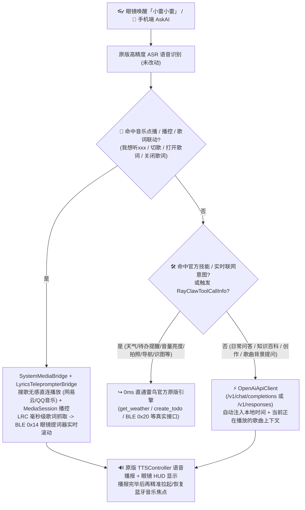

# 👓 LovelyRayNeoio

> 为 **雷鸟 io (`rayneo_io`)** / 雷鸟智能眼镜打造的 **RayNeo AI (`com.rayneo.venus.pub`) 无损自定义大模型接入 + 音乐歌词与眼镜提词器实时联动 + 系统级第三方音乐点歌切歌 + 全量官方技能共存** 自动化补丁工程。

[](#)
[](#)
[](#)
[-E63946)](./LICENSE)

---

## ✨ 为什么做 LovelyRayNeoio？

雷鸟智能眼镜（尤其是 **雷鸟 io**）自带的语音唤醒（「小雷小雷」）、蓝牙收音（ASR）与原厂语音合成（TTS）体验非常顺滑，但受限于固定云端大模型：
1. 无法自由切换自己常用的最新前沿模型；
2. 若简单粗暴地拦截全部对话，会导致 **联网查天气、创建手机待办事项/提醒/倒计时、拍照录像、高德导航** 等官方原生技能失效；
3. 雷鸟 io 官方云端目前 **不支持控制手机第三方音乐播放器（如网易云音乐、QQ音乐）语音搜歌点播、切歌与读取当前播放曲目**，且眼镜自带的 **提词器无法与手机正在播放的音乐歌词联动滚动**。

**LovelyRayNeoio** 采用 `com.rayneo.airuntime` **未混淆桥接层最小侵入拦截方案**，在不破坏原版任何体验的前提下把上述痛点一次性全部打通：

- 🧠 **双协议自定义大模型自由切换**：原生支持 **`/v1/chat/completions`** 与 **`/v1/responses`**（均支持 SSE 流式输出与非流式 JSON），支持思考模型（`reasoning_effort` / `reasoning_content`）、多轮记忆长度调节、自定义请求头与系统提示词，自动注入设备当前本地时间与星期。
- 🎙️ **100% 保留原版 ASR 与原版 TTS（不断流）**：继续使用雷鸟原生离线唤醒 + 高精度语音识别 + 官方 TTS 音色播报；内置 C++ 云端工作流干净停流与状态信号隔离机制，彻底根治长回复播报 3~4 个字自动断流的问题。
- 🎤 **眼镜 HUD 音乐歌词与提词器毫秒级实时联动（支持双语译文 & 日语罗马音，`LyricsTeleprompterBridge`）**：打通系统 `MediaSession` 播放进度插值、网易云音乐 / QQ音乐高精度多轨 `.lrc` 解析引擎与 **雷鸟 io (`SmallCore`)** 蓝牙提词器真实线协议（动态反射解析 `CoreConnect` 通道，无惧 R8 混淆重排）：
  - **支持四档显示模式（双语 / 罗马音 / 三语 / 仅原词）**：内置 **「双语译文」**（默认，外语歌自动对齐中文翻译）、**「原词+罗马音」**（自动拉取网易云汉字注音 `romalrc`，QQ音乐播放日语歌时自动跨平台借用网易云罗马音，纯假名段落内置离线平文式罗马音转写兜底）、**「三语全显」**（原词 + `~ 罗马音` + `· 中文译文` 锚定同屏显示）与 **「仅原词」**；
  - **支持语音与面板一键切换**：直接对眼镜说 **`「打开歌词 / 打开双语歌词 / 打开罗马音 / 切换到三语歌词 / 仅显示原词 / 关闭歌词」`**，也可在 `⚡LLM` 面板切换模式或点击 **「📤 剪贴板投送眼镜」**；
  - **原版中日英文歌词精准命中**：专用歌词解析器完整保留 VIP/灰标无版权原曲（歌词接口免费返回），支持日语歌曲 `tns` 译名后缀匹配（如 `クリスマスソング (圣诞颂歌) - back number`）、多歌手分词（`/`、`&`、`、`）与时长对齐，自动剔除未请求的 `Cover/翻唱/伴奏/DJ/Live`；
  - **自动进入实时提词 · 整首零刷屏逐行推进**：每首歌仅在开场通过 `0x02 (countdown=3) -> fileShare -> 0x02 (code=7) -> 550ms 预览就绪 -> 0x03` 自动进入提词（**无需手动触碰镜腿播放键**），随后全程通过轻量 `0x08 ProgressUpdate` 毫秒级推进并自动锚定原词主行（双语/三语绝不跳行切半），整首零重传、零死机；
  - **无感避让与槽位隔离**：固定复用单一歌词槽位 DID（不污染用户原有提词文稿）并拦截专属回包避免官方 Flutter 冲突；唤醒「小雷小雷」期间自动暂挂推送，镜腿手动退出提词后本首不再强弹（切歌自动恢复）。
- 🧩 **轻量可扩展 MCP 与 Skills 技能引擎（`McpSkillManager`）**：双协议（`/v1/chat/completions` 与 `/v1/responses` 流式/非流式）原生支持多轮 Function Calling 工具调用闭环，遇到不支持 `tools` 的模型自动无感降级重试：
  - **内置眼镜本地技能**：开箱自带 `push_to_teleprompter`（一句话生成演讲提纲/要点直接投送到眼镜提词器常驻显示）、`clipboard_manage`（读取/翻译/总结手机剪贴板或将 AI 结果写入剪贴板）、`get_phone_status`（查询手机实时电量与播放状态），后续扩展新原生技能仅需调用 `McpSkillManager.registerBuiltinSkill(...)`；
  - **自定义 JSON Skills**：支持声明式 **Prompt 规范技能**（动态注入 SOP 指令）与 **HTTP Webhook 动作技能**（一键对接飞书/钉钉机器人、Notion、HomeAssistant、OpenClaw 等）；
  - **远程 / 局域网 MCP Server 接入**：内置标准 **MCP Streamable HTTP (`JSON-RPC 2.0`)** 客户端（支持 `initialize` 会话握手、`tools/list` 工具发现缓存、`tools/call` JSON/SSE 双格式解析），兼容数组格式与 Claude/Cursor 标准 `{"mcpServers": {...}}` 配置格式，面板内支持一键 **「🔍 探测 MCP 工具」**。
- 🎵 **突破官方限制：语音搜歌点播 + 系统级第三方音乐切歌 + 实时曲目抓取（`SystemMediaBridge`）**：直接联动 **网易云音乐 / QQ音乐深度播控协议** 与 Android `MediaSessionManager`（兼容汽水音乐、酷狗、Apple Music、Spotify、哔哩哔哩等）：
  - **🎤 语音直接点歌播放（新增）**：直接对眼镜或手机说 **`「我想听李荣浩的模特」「我想听李荣浩」「放一首周杰伦的晴天」「用QQ音乐放陈奕迅的十年」`**，自动检索正版录音室音源（自动过滤灰色无版权曲目与伴奏/翻唱，单说歌手名时自动避开正在放的歌轮换热曲），先由眼镜语音播报歌名再无感后台拉起播放，不刷屏跳转播放器全屏页、不清空原有播放列表！同时支持 **`「我想听每日推荐 / 放点日推」「打开私人FM」`**；
  - **⏭️ 系统级切歌与播控**：支持语音 **`切歌 / 下一首`、`上一首`、`暂停播放`、`继续播放`、`收藏这首歌`**；
  - 切歌后自动轮询读取新曲目元数据，在眼镜与耳机中实时播报 **`已切到下一首：歌手《歌名》（网易云音乐）`**，并在播报结束后自动恢复蓝牙播放焦点；
  - 支持直接问 **`「现在放的是什么歌 / 这首歌叫什么」`**，毫秒级读取系统正在播放的曲目；
  - 每次自定义大模型对话自动附带 `[当前手机系统音乐播放器状态：…]`，可直接问眼镜 **`「介绍一下现在放的这首歌」「推荐几首和现在这首风格像的歌」`**！
- 🛠️ **官方全量技能与联网实时工具零误杀直通**：
  - **联网实时信息**：`今天天气怎么样`、`明天会下雨吗`、`今日新闻/汇率/金价` 等自动走官方 `get_weather` / 联网搜索工具；
  - **真实落库的待办/提醒/日程/闹钟**：`提醒我十分钟后喝水`、`定个五分钟倒计时`、`建个待办明天交报告` 真实触发官方 `create_todo` / `set_reminder` 写入雷鸟 App 待办与眼镜提醒；
  - **硬件播控与随身能力**：调音量、调亮度、查电量、拍照/连拍/录像/录音、拨打/接听电话、高德地图路线导航、拍图识物、同声传译、随身记忆全部原样保留。
- 📱 **手机端内建暗黑配置面板 & 全链路调用审计**：无需反编译改配置，在雷鸟 App 内点击右上角可拖拽 **`⚡LLM` 悬浮球**（或 **连按 3 次音量+**）即可随时改配置、一键测速、剪贴板导入/导出配置，以及在 **「📜 查看调用历史」** 中核验最近 30 次请求的耗时、流式分片与工具调用明细。
- 🚀 **1 分钟无感升级新版官方 APK**：全部新增逻辑独立编译为追加 `classes{N+1}.dex`，对原包仅在 5 个桥接类中按语义锚点注入钩子（`MOD-01 ~ MOD-05`），未来官方更新 APK 时一键重打补丁即可直接覆盖安装。

---

## 🏗️ 整体路由架构



---

## 📦 环境要求

在本地从官方 APK 构建补丁包仅需以下基础环境（支持 **Windows / macOS / Linux**）：

1. **Python 3.9+**
2. **JDK 17+**（配置 `JAVA_HOME` 或加入系统 `PATH`）
3. **Android SDK**（配置 `ANDROID_HOME` 或 `ANDROID_SDK_ROOT`）：
   - `platforms;android-34`（或更高版本，如 `android-35` / `android-36`）
   - `build-tools;34.0.0`（或更高版本，需包含 `d8`、`zipalign`、`apksigner`）
4. **官方原版安装包**：自行从雷鸟官方渠道下载 `RayNeo_AI_1.0.25.apk`（兼容 `1.0.20` 及更新版本，**本仓库不包含任何官方 APK 文件**）。

---

## 🚀 快速开始：构建与安装教程

### 第一步：克隆仓库并准备官方 APK

```bash
git clone https://github.com/Tokeii0/LovelyRayNeoio.git
cd LovelyRayNeoio
```

将下载好的雷鸟官方原版 APK（例如 `RayNeo_AI_1.0.25.apk`）放到项目根目录或任意位置。

### 第二步：一键生成自定义 AI 版 APK

- **方式 A（Windows 拖拽一键构建）**：  
  直接鼠标按住 `RayNeo_AI_1.0.25.apk`，拖放到根目录的 **`upgrade_apk.bat`** 图标上松开即可。

- **方式 B（跨平台命令行构建）**：
  ```bash
  python custom_ai_mod/patch_apk.py RayNeo_AI_1.0.25.apk
  ```
  构建脚本会自动完成：
  1. 编译 `com.rayneo.customai.*` 源码为独立追加 DEX（`CoreConnect` 蓝牙通道采用动态特征反射，无惧 R8 混淆重排）；
  2. 自动定位目标 DEX（含动态扫描定位 `MOD-05` 蓝牙桥接类）并注入 `MOD-01 ~ MOD-05` 钩子；
  3. 运行 `d8` 跨 DEX 联合字节码校验 + **全量 APK 跨 DEX 符号链接核验（确保 0 缺失类/字段/方法）**；
  4. 执行 Android 15+ 要求的 `zipalign -P 16`（16KB 页对齐）；
  5. 若本地不存在 `custom_ai_mod/keys/rayneo_custom_ai.jks`，**首次运行会自动调用 `keytool` 生成你本地专属的签名密钥库** 并完成 V1+V2+V3 签名校验，最终在同目录输出 `RayNeo_AI_1.0.25_CustomAI.apk`。

> ⚠️ **请妥善保留生成的 `custom_ai_mod/keys/rayneo_custom_ai.jks`！**  
> 只要后续升级继续使用同一个 `.jks` 签名，即可永远使用「覆盖安装」更新，无需卸载重配。

### 第三步：安装到手机（首次安装 vs 后续更新）

#### 1. 首次安装（从官方原版切换到 LovelyRayNeoio）
由于自定义签名与雷鸟官方出厂签名不同，**仅第一次切换时**需要先卸载手机上的官方原版 App，然后安装构建出的 `RayNeo_AI_1.0.25_CustomAI.apk`：

```bash
adb install RayNeo_AI_1.0.25_CustomAI.apk
```

安装后打开雷鸟 App：
1. 正常登录雷鸟账号并配对连接 **雷鸟 io** 眼镜；
2. 按照雷鸟 App 引导开启手机系统的 **「通知使用权 / 通知读取权限」**（不仅用于眼镜通知播报，`SystemMediaBridge` 也会直接复用该权限从系统 `MediaSessionManager` 实时抓取网易云音乐/QQ音乐的歌名与歌手，无需任何额外权限）。

#### 2. 后续升级更新（切勿卸载！）
之后每次修改代码或跟进雷鸟官方新版 APK 重新打包后，**严禁卸载旧包**，直接执行覆盖安装即可：

```bash
adb install -r RayNeo_AI_1.0.25_CustomAI.apk
```
（或将 APK 发到手机直接点击「覆盖更新」），**登录状态、雷鸟 io 蓝牙配对、自定义 API Key 与历史记录将 100% 原样保留！**

---

## ⚙️ 自定义大模型配置与使用指南

### 1. 打开配置面板（两种入口）
- **入口一**：点击雷鸟 App 右上角/侧边可自由拖拽的 **`⚡LLM` 胶囊悬浮球**（请求过程中会实时变为 `⚡请求中…` / `⚡输出中…` / `⚡播报中…`）。
- **入口二**：若你在设置中隐藏了悬浮球，可在雷鸟 App 主界面 **1.5 秒内连续按 3 次手机「音量 +」键** 呼出配置面板。

### 2. 填写接口参数
| 配置项 | 说明与建议 |
| :--- | :--- |
| **接口协议** | 支持一键切换 **`/chat/completions`**（Gemini、DeepSeek、百炼、Kimi、智谱、火山方舟、硅基流动、OpenRouter、NewAPI 等通用）与 **`/responses`**（OpenAI 原生 Responses API，`GPT-6 / GPT-6.1` 系列推荐） |
| **快捷预设** | 顶部提供 **`OpenAI Resp`、`Gemini 4`、`DeepSeek`、`阿里百炼`、`Kimi K3.1`、`OpenRouter`** 一键填入最新模板，填入后可自由修改任意模型 ID |
| **Base URL** | 自动补全路径：填 `https://api.openai.com`、`https://openrouter.ai/api/v1` 或完整 `/v1/chat/completions` 均可自动识别。<br>*(注：遵循 Android 9+ 网络安全策略，请使用 **`https://`** 地址)* |
| **API Key** | 填写对应平台的 `sk-...` 密钥（仅保存在手机本地应用私有目录 `SharedPreferences`） |
| **模型名称 (Model)** | 如 `gpt-6-luna`、`gpt-6.1-terra`、`gpt-6-astra`、`gemini-4-hydrogen`、`gemini-4-carbon`、`claude-sonnet-5-5`、`deepseek-flash`、`qwen3.8-flash`、`kimi-k3.1-pro`、`glm-5.3-flash` 等 |
| **思考强度 (Reasoning Effort)** | 眼镜随身语音建议留空或选 `low`（首字响应更快）；复杂推理问答可选 `medium` / `high` |
| **官方功能指令交给原版执行** | **建议保持开启（默认开启）**，确保天气、待办提醒、拍照、导航等全部走雷鸟官方真实接口 |
| **🎤 音乐歌词实时联动眼镜提词器** | 开启后，手机播放音乐时自动抓取网易云音乐 / QQ音乐时间轴歌词并实时滚动投送到眼镜提词器 HUD；也可点击下方 **「🎵 立即同步当前歌曲歌词到眼镜」** 或直接语音说「打开歌词 / 关闭歌词」 |
| **播报完自动开启下一轮拾音** | 默认关闭（推荐关闭，避免眼镜刚显示完回答就被下一轮收音清屏） |

### 3. 🌟 各大平台最新模型填写速查表（2026.11 最新梳理）

> 👓 **配镜选模建议**：智能眼镜语音交互对**首字延迟（TTFT）**高度敏感，日常随身对话强烈优先推荐下表中的 **「眼镜极速秒回推荐」**（各家最新 `Flash` / `Luna` / `Hydrogen` / `Haiku 5.5` / `Highspeed` 档，普遍具备 1M 上下文且毫秒级起播）；手机端 `Ask AI` 深度长文问答可随时切到右侧 **「旗舰满血 / 深度推理档」**。

| 平台 / 厂商 | 官方兼容 Base URL | 协议选择 | 👓 眼镜极速秒回推荐 (低延迟首选) | 🧠 旗舰满血 / 深度推理推荐 |
| :--- | :--- | :--- | :--- | :--- |
| **OpenAI** | `https://api.openai.com/v1` | `/responses` 或 `/chat/completions` | `gpt-6-luna` / `gpt-6.1-sol` | `gpt-6-astra` / `gpt-6.1-terra-pro` / `gpt-6.1-terra` |
| **Google Gemini** | `https://generativelanguage.googleapis.com/v1beta/openai` | `/chat/completions` | `gemini-4-hydrogen` / `gemini-3.8-flash` / `gemini-omni-1.2-flash` | `gemini-4-carbon` / `gemini-4-argon` |
| **Anthropic Claude** *(兼容网关)* | `https://openrouter.ai/api/v1` *(或自建 NewAPI)* | `/chat/completions` | `claude-haiku-5-5` / `claude-sonnet-5-5` *(OpenRouter 加 `anthropic/` 前缀，小数点写 `.`)* | `claude-opus-5-5` / `claude-fable-5-2` |
| **DeepSeek 官方** | `https://api.deepseek.com/v1` | `/chat/completions` | `deepseek-flash` *(指向最新 `DeepSeek-V4.1-Flash-1017`)* | `deepseek-v4-pro` *(指向 `DeepSeek-V4-Pro-0813`)* |
| **阿里云百炼 (通义千问)** | `https://dashscope.aliyuncs.com/compatible-mode/v1` | `/chat/completions` | `qwen3.8-flash` / `qwen3.8-omni-flash` | `qwen4-max-preview` / `qwen3.8-max` |
| **月之暗面 (Kimi)** | `https://api.moonshot.cn/v1` | `/chat/completions` | `kimi-k3.1-pro-highspeed` / `kimi-k3` | `kimi-k3.1-pro` |
| **智谱 BigModel (GLM)** | `https://open.bigmodel.cn/api/paas/v4` | `/chat/completions` | `glm-5.3-flash` / `glm-5.3-flashx` | `glm-5.3` / `glm-5.3-prime` / `glm-5.2` |
| **字节火山方舟 (豆包 Seed)** | `https://ark.cn-beijing.volces.com/api/v3` | `/chat/completions` | `doubao-seed-2-1-turbo` / `doubao-seed-2-0-lite` *(或方舟接入点 `ep-...`)* | `doubao-seed-2-1-pro` / `doubao-seed-evolving` |
| **MiniMax** | `https://api.minimaxi.com/v1` | `/chat/completions` | `MiniMax-M3.1-Flash` | `MiniMax-M3` |
| **xAI (Grok)** | `https://api.x.ai/v1` | `/chat/completions` | `grok-4.6` / `grok-4.7` | `grok-4.7` |
| **硅基流动 (SiliconFlow)** | `https://api.siliconflow.cn/v1` | `/chat/completions` | `deepseek-ai/DeepSeek-V4.1-Flash` / `MiniMaxAI/MiniMax-M3.1-Flash` | `deepseek-ai/DeepSeek-V4-Pro` / `MiniMaxAI/MiniMax-M3` |
| **OpenRouter 聚合网关** | `https://openrouter.ai/api/v1` | `/chat/completions` | `google/gemini-4-hydrogen` / `openai/gpt-6-luna` / `deepseek/deepseek-v4.1-flash-1017` / `anthropic/claude-haiku-5.5` | `openai/gpt-6-astra` / `google/gemini-4-carbon` / `anthropic/claude-opus-5.5` / `anthropic/claude-fable-5.2` |

> ⚠️ **近期各厂模型更替与参数避坑提示**：
> 1. **DeepSeek 官方接口**：旧版 `deepseek-chat` 与 `deepseek-reasoner` **已正式停用下线**，直连 `api.deepseek.com` 请务必填写 **`deepseek-flash`** 或 **`deepseek-v4-pro`**。
> 2. **Kimi 官方接口**：旧版 `moonshot-v1-*` 与 `kimi-k2.5` 已下线，请填写 **`kimi-k3.1-pro-highspeed`**（2~3 倍高速版，极适合眼镜语音）或 **`kimi-k3.1-pro`**。
> 3. **Gemini 4 / 3.6+ 采样参数变更**：Google 官方自 `Gemini 3.6` 与 `Gemini 4` 系列起已废弃 `temperature` 参数，本项目 `OpenAiApiClient` **已内置自动识别豁免逻辑**，填写 `gemini-4-hydrogen` / `gemini-4-carbon` 时会自动剔除 `temperature` 字段，直连不会报错。
> 4. **其他新锐开源/国产模型（OpenRouter 可直接体验）**：腾讯混元 **`tencent/hy4`**、百度文心 **`baidu/ernie-5.5-flash-preview`**、Mistral **`mistralai/mistral-large-4-0`** 均支持标准 `/chat/completions` 流式接入。

填写完成后，点击面板内的 **「🔌 发送测试请求」**，看到返回 `✅ 连接成功` 与延迟毫秒数后，点击 **「💾 保存并立即生效」** 即可！  
*(面板底部还支持 **「📋 导出配置」 / 「📥 导入配置」**，方便通过剪贴板备份或迁移整套 JSON 配置。)*

---

## 🗣️ 语音指令能力速查表

唤醒眼镜说出 **「小雷小雷」**（或在手机端「Ask AI」页面直接输入/提问）：

| 场景分类 | 语音示例 | 实际执行引擎 |
| :--- | :--- | :--- |
| **📜 歌词联动 & 双语/罗马音** | 「打开歌词」「打开双语歌词」「打开罗马音」「切换到三语歌词」「仅显示原词」「关闭歌词」 | **本地 `LyricsTeleprompterBridge`**（多轨 `.lrc` 对齐 + 罗马音转写 + `BLE 0x14` 锚定逐行同步） |
| **🧩 本地技能 & MCP 工具** | 「帮我拟个三分钟演讲提纲投到眼镜提词器上」「总结一下我手机剪贴板里的内容」 | **自定义大模型 + `McpSkillManager`**（多轮 Function Calling 调用内置技能 / Webhook / MCP Server） |
| **🎤 语音搜歌点播** | 「我想听李荣浩的模特」「我想听李荣浩」「放一首晴天」「用QQ音乐放陈奕迅的十年」「我想听每日推荐」「打开私人FM」 | **本地 `SystemMediaBridge`**（检索正版曲库 + 播报歌名后无感后台拉起网易云音乐/QQ音乐直播） |
| **🎵 音乐切歌与播控** | 「切歌」「下一首歌」「切回上一首」「暂停播放」「继续播放」「收藏这首歌」 | **本地 `SystemMediaBridge`**（直接控制网易云音乐/QQ音乐/Spotify 等并播报新歌名） |
| **🎶 实时识曲与歌曲提问** | 「现在放的是什么歌」「这首歌叫什么」「介绍一下现在放的这首歌」「推荐几首风格差不多的歌」 | **本地曲目抓取 + 自定义大模型**（自动读取当前系统播放曲目注入上下文） |
| **🌤️ 天气与实时联网** | 「今天天气怎么样」「明天杭州会下雨吗」「今天黄金多少钱一克」 | **雷鸟官方引擎**（`get_weather` / 实时搜索工具 + 原生播报） |
| **⏰ 待办 / 提醒 / 倒计时** | 「提醒我十分钟后喝水」「定个五分钟的倒计时」「帮我建个待办明天交周报」 | **雷鸟官方引擎**（`create_todo` / `set_reminder` 真实写入待办与眼镜提醒） |
| **🎛️ 眼镜硬件与媒体** | 「声音大一点」「调暗一点」「还有多少电」「帮我拍张照」「开始录像」「开始录音」 | **雷鸟官方引擎**（离线/云端硬件指令 + `BLE 0x20`） |
| **🗺️ 电话 / 导航 / 识物** | 「打电话给张三」「导航去深圳北站」「帮我看看这是什么」「打开同声传译」 | **雷鸟官方引擎**（通讯 / 高德导航 / 视觉多模态 / 同传） |
| **💡 开放式 AI 问答与对话** | 「用通俗的话解释量子纠缠」「给我讲个冷笑话」「帮我构思一段演讲开头」 | **⚡ 你配置的自定义大模型**（流式显示 + 原厂 TTS 播报） |

> 💡 **如何确认某一句话到底调了哪个接口？**  
> 随时打开 **`⚡LLM -> 📜 查看调用历史`**，每条记录都会清晰标注是走你的 **自定义模型**、**`🎵 系统媒体播控 & 曲目抓取`** 还是 **`↪ 官方技能/联网引擎`**，点开详情还能看到精确到毫秒的 `RAYCLAW_TOOL(tool=...)`、`OFFICIAL_NLP(domain=..., cmd=..., params=...)` 与 `MEDIA_AFTER(song=...)` 执行轨迹！

---

## 📂 项目目录结构

```text
LovelyRayNeoio/
├── LICENSE                             # AGPLv3 + Commons Clause 协议（严禁收费 · 强制开源）
├── README.md                           # 项目说明、构建安装与使用文档
├── MODIFICATION_GUIDE.md               # 逆向架构细节与注入点技术规范说明
├── upgrade_apk.bat                     # Windows 拖拽 APK 一键打补丁脚本
└── custom_ai_mod/
    ├── patch_apk.py                    # 跨平台自动化解包、编译、Smali 注入、D8 校验与重签名主脚本
    ├── annotations/
    │   └── diffs/                      # 自动生成的 MOD-01 ~ MOD-05 Unified Diff 审计补丁记录
    ├── keys/                           # 本地签名证书目录（首次构建自动生成，已加入 .gitignore）
    ├── tools/lib/                      # 内置 baksmali / smali 3.0.9 依赖库
    ├── stubs/                          # airuntime 与 CoreConnect 编译期轻量接口桩（不打包进最终 DEX）
    ├── tests/
    │   └── TestOpenAiClient.java       # 双协议 SSE/JSON、意图分流、媒体点歌与歌词提词器协议单元测试
    └── src/com/rayneo/customai/
        ├── CustomAiHooks.java          # 核心桥接调度器：系统播控 + 歌词联动 + 三层官方技能分流 + 自定义 LLM
        ├── LyricsTeleprompterBridge.java# 多轨双语/罗马音 LRC 解析引擎 & 眼镜 BLE 提词器握手与毫秒级进度同步驱动
        ├── McpSkillManager.java        # 轻量可扩展 MCP (Streamable HTTP JSON-RPC 2.0) 与本地/Webhook/Prompt Skills 引擎
        ├── SystemMediaBridge.java      # Android MediaSessionManager 第三方播放器控制、语音点歌与实时曲目抓取
        ├── OpenAiApiClient.java        # 零第三方依赖双协议流式客户端 + 多轮 Function Calling 工具执行闭环
        ├── RayNeoOriginalTtsBridge.java# 复用雷鸟原厂 TTSController 语音播报与防断流看门狗
        ├── CustomAiSettingsDialog.java # 纯自绘主题解耦暗黑配置面板与调用历史查看器
        ├── CustomAiFloatingBadge.java  # 应用内可拖拽 ⚡LLM 实时状态悬浮胶囊按钮
        ├── CustomAiCallLog.java        # 线程安全最近 30 笔调用审计日志与事件时间线
        ├── CustomAiConfig.java         # 配置持久化、JSON 导入导出与 AskAI 传输同步
        ├── ConversationMemory.java     # 按会话隔离的滑动窗口多轮上下文记忆
        └── JsonMini.java               # 轻量纯 Java JSON 解析与序列化工具
```

---

## 🧪 运行本地单元测试

修改 Java 代码后，可直接运行内置纯 JVM 单元测试验证双协议 SSE/JSON 解析、思考模型参数规则、混合意图路由与媒体播控匹配逻辑：

```bash
python -c "import glob,subprocess; st=glob.glob('custom_ai_mod/stubs/**/*.java',recursive=True); sr=glob.glob('custom_ai_mod/src/**/*.java',recursive=True); aj=r'$ANDROID_HOME/platforms/android-36/android.jar'; subprocess.run(['javac','-encoding','UTF-8','-source','8','-target','8','-bootclasspath',aj,'-d','build_test']+st+sr,check=True); subprocess.run(['javac','-encoding','UTF-8','-source','8','-target','8','-cp','build_test:'+aj,'-d','build_test','custom_ai_mod/tests/TestOpenAiClient.java'],check=True); subprocess.run(['java','-cp','build_test:'+aj,'TestOpenAiClient'],check=True)"
```
*(Windows 下将 `-cp` 分隔符 `:` 换为 `;` 即可。)*

---

## 📜 开源协议（严禁收费 · 强制开源）

本项目采用 **[GNU AGPLv3 + Commons Clause v1.0（禁止商用收费附加条款）](./LICENSE)** 授权：

- 🚫 **严禁任何形式收费（No Charging / Non-Commercial）**：严禁出售本项目源码、脚本或打包后的修改版 APK；严禁在闲鱼、淘宝、拼多多、付费群、知识星球等任何渠道以「代改费、安装指导费、激活码/卡密、赞助下载门槛、硬件捆绑溢价」等任何名义变相牟利。若你在任何地方看到有人收费售卖本项目产物，请直接举报并认准本免费开源仓库。
- 🔓 **强制完整开源（Mandatory Open-Source / Strong Copyleft）**：任何基于本项目的修改、二次开发、衍生版本、重新打包分发或云端网络服务，**必须同样免费向所有用户完整公开修改后的全部源代码与构建脚本**，并完整保留本协议与原作者署名，严禁闭源二改。

---

## ⚖️ 免责声明 (Disclaimer)

1. 本仓库 **仅包含开源补丁脚本与自定义扩展源码**，**不包含、不分发** 任何雷鸟官方 APK、闭源 SDK 或受版权保护的二进制资源文件。
2. 本项目仅供智能眼镜爱好者进行个人学习、大模型接入实验与系统互操作性研究使用，请勿用于任何商业用途或非法用途。
3. 「雷鸟」「RayNeo」及相关商标归其各自权利人所有。
