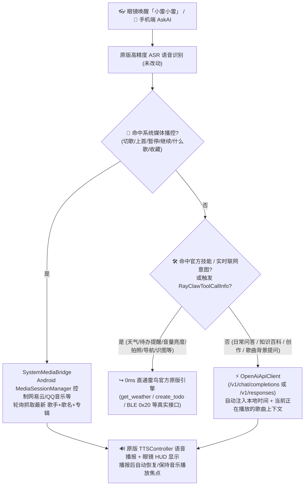

# 👓 LovelyRayNeoio

> 为 **雷鸟 io (`rayneo_io`)** / 雷鸟智能眼镜打造的 **RayNeo AI (`com.rayneo.venus.pub`) 无损自定义大模型接入 + 系统级第三方音乐切歌识曲 + 全量官方技能共存** 自动化补丁工程。

[](#)
[](#)
[](#)
[-E63946)](./LICENSE)

---

## ✨ 为什么做 LovelyRayNeoio？

雷鸟智能眼镜（尤其是 **雷鸟 io**）自带的语音唤醒（「小雷小雷」）、蓝牙收音（ASR）与原厂语音合成（TTS）体验非常顺滑，但受限于固定云端大模型：
1. 无法自由切换自己常用的 **OpenAI (`GPT-5.4` / `GPT-5.4-mini`)、Claude (`Claude Sonnet 4.6` / `Opus 4.6`)、Gemini (`Gemini 3.1 Pro` / `Gemini 3.5 Flash`)、DeepSeek (`DeepSeek-V3.2`)、千问 (`Qwen3.5` / `Qwen3.8-Max`)、Kimi (`Kimi-K2.5`)、智谱 (`GLM-5`)** 以及 **OpenRouter / OneAPI / NewAPI** 等最新前沿模型；
2. 若简单粗暴地拦截全部对话，会导致 **联网查天气、创建手机待办事项/提醒/倒计时、拍照录像、高德导航** 等官方原生技能失效；
3. 雷鸟 io 官方云端目前 **不支持控制手机第三方音乐播放器（如网易云音乐、QQ音乐）切歌与读取当前播放曲目**。

**LovelyRayNeoio** 采用 `com.rayneo.airuntime` **未混淆桥接层最小侵入拦截方案**，在不破坏原版任何体验的前提下把上述痛点一次性全部打通：

- 🧠 **双协议自定义大模型自由切换**：原生支持 **`/v1/chat/completions`** 与 **`/v1/responses`**（均支持 SSE 流式输出与非流式 JSON），支持思考模型（`reasoning_effort` / `reasoning_content`）、多轮记忆长度调节、自定义请求头与系统提示词，自动注入设备当前本地时间与星期。
- 🎙️ **100% 保留原版 ASR 与原版 TTS（不断流）**：继续使用雷鸟原生离线唤醒 + 高精度语音识别 + 官方 TTS 音色播报；内置 C++ 云端工作流干净停流与状态信号隔离机制，彻底根治长回复播报 3~4 个字自动断流的问题。
- 🎵 **突破官方限制：系统级第三方音乐切歌 + 实时曲目抓取（`SystemMediaBridge`）**：直接联动 Android `MediaSessionManager` 控制 **网易云音乐、QQ音乐、汽水音乐、酷狗、Apple Music、Spotify、哔哩哔哩** 等主流播放器：
  - 支持语音 **`切歌 / 下一首`、`上一首`、`暂停播放`、`继续播放`、`收藏这首歌`**；
  - 切歌后自动轮询读取新曲目元数据，在眼镜与耳机中实时播报 **`已切到下一首：歌手《歌名》（网易云音乐）`**，并在播报结束后自动恢复蓝牙播放焦点；
  - 支持直接问 **`「现在放的是什么歌 / 这首歌叫什么」`**，毫秒级读取系统正在播放的曲目；
  - 每次自定义大模型对话自动附带 `[当前手机系统音乐播放器状态：…]`，可直接问眼镜 **`「介绍一下现在放的这首歌」「推荐几首和现在这首风格像的歌」`**！
- 🛠️ **官方全量技能与联网实时工具零误杀直通**：
  - **联网实时信息**：`今天天气怎么样`、`明天会下雨吗`、`今日新闻/汇率/金价` 等自动走官方 `get_weather` / 联网搜索工具；
  - **真实落库的待办/提醒/日程/闹钟**：`提醒我十分钟后喝水`、`定个五分钟倒计时`、`建个待办明天交报告` 真实触发官方 `create_todo` / `set_reminder` 写入雷鸟 App 待办与眼镜提醒；
  - **硬件播控与随身能力**：调音量、调亮度、查电量、拍照/连拍/录像/录音、拨打/接听电话、高德地图路线导航、拍图识物、同声传译、随身记忆全部原样保留。
- 📱 **手机端内建暗黑配置面板 & 全链路调用审计**：无需反编译改配置，在雷鸟 App 内点击右上角可拖拽 **`⚡LLM` 悬浮球**（或 **连按 3 次音量+**）即可随时改配置、一键测速、剪贴板导入/导出配置，以及在 **「📜 查看调用历史」** 中核验最近 30 次请求的耗时、流式分片与工具调用明细。
- 🚀 **1 分钟无感升级新版官方 APK**：全部新增逻辑独立编译为追加 `classes{N+1}.dex`，对原包仅在 4 个未混淆桥接类中按语义锚点注入钩子，未来官方更新 APK 时一键重打补丁即可直接覆盖安装。

---

## 🏗️ 整体路由架构



---

## 📦 环境要求

在本地从官方 APK 构建补丁包仅需以下基础环境（支持 **Windows / macOS / Linux**）：

1. **Python 3.9+**
2. **JDK 17+**（配置 `JAVA_HOME` 或加入系统 `PATH`）
3. **Android SDK**（配置 `ANDROID_HOME` 或 `ANDROID_SDK_ROOT`）：
   - `platforms;android-34`（或更高版本，如 `android-35` / `android-36`）
   - `build-tools;34.0.0`（或更高版本，需包含 `d8`、`zipalign`、`apksigner`）
4. **官方原版安装包**：自行从雷鸟官方渠道下载 `RayNeo_AI_1.0.20.apk`（或更新版本，**本仓库不包含任何官方 APK 文件**）。

---

## 🚀 快速开始：构建与安装教程

### 第一步：克隆仓库并准备官方 APK

```bash
git clone https://github.com/Tokeii0/LovelyRayNeoio.git
cd LovelyRayNeoio
```

将下载好的雷鸟官方原版 APK（例如 `RayNeo_AI_1.0.20.apk`）放到项目根目录或任意位置。

### 第二步：一键生成自定义 AI 版 APK

- **方式 A（Windows 拖拽一键构建）**：  
  直接鼠标按住 `RayNeo_AI_1.0.20.apk`，拖放到根目录的 **`upgrade_apk.bat`** 图标上松开即可。

- **方式 B（跨平台命令行构建）**：
  ```bash
  python custom_ai_mod/patch_apk.py RayNeo_AI_1.0.20.apk
  ```
  构建脚本会自动完成：
  1. 编译 `com.rayneo.customai.*` 源码为独立追加 DEX；
  2. 自动定位目标 DEX 并注入 `MOD-01 ~ MOD-04` 桥接钩子；
  3. 运行 `d8` 跨 DEX 联合字节码与寄存器校验；
  4. 执行 Android 15+ 要求的 `zipalign -P 16`（16KB 页对齐）；
  5. 若本地不存在 `custom_ai_mod/keys/rayneo_custom_ai.jks`，**首次运行会自动调用 `keytool` 生成你本地专属的签名密钥库** 并完成 V1+V2+V3 签名校验，最终在同目录输出 `RayNeo_AI_1.0.20_CustomAI.apk`。

> ⚠️ **请妥善保留生成的 `custom_ai_mod/keys/rayneo_custom_ai.jks`！**  
> 只要后续升级继续使用同一个 `.jks` 签名，即可永远使用「覆盖安装」更新，无需卸载重配。

### 第三步：安装到手机（首次安装 vs 后续更新）

#### 1. 首次安装（从官方原版切换到 LovelyRayNeoio）
由于自定义签名与雷鸟官方出厂签名不同，**仅第一次切换时**需要先卸载手机上的官方原版 App，然后安装构建出的 `RayNeo_AI_1.0.20_CustomAI.apk`：

```bash
adb install RayNeo_AI_1.0.20_CustomAI.apk
```

安装后打开雷鸟 App：
1. 正常登录雷鸟账号并配对连接 **雷鸟 io** 眼镜；
2. 按照雷鸟 App 引导开启手机系统的 **「通知使用权 / 通知读取权限」**（不仅用于眼镜通知播报，`SystemMediaBridge` 也会直接复用该权限从系统 `MediaSessionManager` 实时抓取网易云音乐/QQ音乐的歌名与歌手，无需任何额外权限）。

#### 2. 后续升级更新（切勿卸载！）
之后每次修改代码或跟进雷鸟官方新版 APK 重新打包后，**严禁卸载旧包**，直接执行覆盖安装即可：

```bash
adb install -r RayNeo_AI_1.0.20_CustomAI.apk
```
（或将 APK 发到手机直接点击「覆盖更新」），**登录状态、雷鸟 io 蓝牙配对、自定义 API Key 与历史记录将 100% 原样保留！**

---

## ⚙️ 自定义大模型配置与使用指南

### 1. 打开配置面板（两种入口）
- **入口一**：点击雷鸟 App 右上角/侧边可自由拖拽的 **`⚡LLM` 胶囊悬浮球**（请求过程中会实时变为 `⚡请求中…` / `⚡输出中…` / `⚡播报中…`）。
- **入口二**：若你在设置中隐藏了悬浮球，可在雷鸟 App 主界面 **1.5 秒内连续按 3 次手机「音量 +」键** 呼出配置面板。

### 2. 填写接口参数
| 配置项 | 说明与建议 |
| :--- | :--- |
| **接口协议** | 支持一键切换 **`/chat/completions`**（OpenRouter、DeepSeek、百炼、硅基流动、NewAPI 等通用）与 **`/responses`**（OpenAI 原生 Responses API，`GPT-5.4` 系列推荐） |
| **快捷预设** | 顶部提供 `OpenAI Chat`、`OpenAI Resp`、`DeepSeek`、`SiliconFlow`、`阿里百炼兼容` 一键填入模板，填入后可自由修改模型 ID |
| **Base URL** | 自动补全路径：填 `https://api.openai.com`、`https://openrouter.ai/api/v1` 或完整 `/v1/chat/completions` 均可自动识别。<br>*(注：遵循 Android 9+ 网络安全策略，请使用 **`https://`** 地址)* |
| **API Key** | 填写对应平台的 `sk-...` 密钥（仅保存在手机本地应用私有目录 `SharedPreferences`） |
| **模型名称 (Model)** | 如 `gpt-5.4`、`gpt-5.4-mini`、`claude-sonnet-4-6`、`gemini-3.5-flash`、`deepseek-v3.2`、`qwen3.5-plus`、`kimi-k2.5`、`glm-5` 等 |
| **思考强度 (Reasoning Effort)** | 眼镜随身语音建议留空或选 `low`（首字响应更快）；复杂推理问答可选 `medium` / `high` |
| **官方功能指令交给原版执行** | **建议保持开启（默认开启）**，确保天气、待办提醒、拍照、导航等全部走雷鸟官方真实接口 |
| **播报完自动开启下一轮拾音** | 默认关闭（推荐关闭，避免眼镜刚显示完回答就被下一轮收音清屏） |

### 3. 🌟 主流新模型填写参考（眼镜端实测推荐）

> 👓 **配镜小贴士**：眼镜语音交互对**首字延迟（TTFT）**敏感，日常随身问答强烈优先推荐各家的 **`Flash` / `Mini` 极速档**或关闭重度深度思考；手机端 `Ask AI` 长文问答可切旗舰满血档。

| 平台 / 厂商 | Base URL 示例 | 协议选择 | 眼镜极速秒回推荐 (低延迟) | 旗舰满血 / 深度推理推荐 |
| :--- | :--- | :--- | :--- | :--- |
| **OpenAI** | `https://api.openai.com/v1` | `/responses` 或 `/chat/completions` | `gpt-5.4-mini` / `gpt-5-mini` | `gpt-5.4` |
| **Anthropic (兼容网关/中转)** | `https://openrouter.ai/api/v1` *(或自建 NewAPI)* | `/chat/completions` | `claude-sonnet-4-6` | `claude-opus-4-6` |
| **Google Gemini** | `https://generativelanguage.googleapis.com/v1beta/openai` | `/chat/completions` | `gemini-3.5-flash` | `gemini-3.1-pro-preview` |
| **DeepSeek 官方** | `https://api.deepseek.com/v1` | `/chat/completions` | `deepseek-v3.2` / `deepseek-chat` | `deepseek-v3.2-speciale` / `deepseek-reasoner` |
| **阿里云百炼 (Qwen)** | `https://dashscope.aliyuncs.com/compatible-mode/v1` | `/chat/completions` | `qwen3.5-flash` / `qwen3.5-plus` | `qwen3.8-max` |
| **月之暗面 (Kimi)** | `https://api.moonshot.cn/v1` | `/chat/completions` | `kimi-k2.5` | `kimi-k2.5` |
| **智谱 BigModel (GLM)** | `https://open.bigmodel.cn/api/paas/v4` | `/chat/completions` | `glm-5.3-flash` | `glm-5` |
| **OpenRouter 聚合** | `https://openrouter.ai/api/v1` | `/chat/completions` | `google/gemini-3.5-flash` | `anthropic/claude-sonnet-4-6` / `openai/gpt-5.4` |

填写完成后，点击面板内的 **「🔌 发送测试请求」**，看到返回 `✅ 连接成功` 与延迟毫秒数后，点击 **「💾 保存并立即生效」** 即可！  
*(面板底部还支持 **「📋 导出配置」 / 「📥 导入配置」**，方便通过剪贴板备份或迁移整套 JSON 配置。)*

---

## 🗣️ 语音指令能力速查表

唤醒眼镜说出 **「小雷小雷」**（或在手机端「Ask AI」页面直接输入/提问）：

| 场景分类 | 语音示例 | 实际执行引擎 |
| :--- | :--- | :--- |
| **🎵 音乐切歌与播控** | 「切歌」「下一首歌」「切回上一首」「暂停播放」「继续播放」「收藏这首歌」 | **本地 `SystemMediaBridge`**（直接控制网易云音乐/QQ音乐/Spotify 等并播报新歌名） |
| **🎶 实时识曲与歌曲提问** | 「现在放的是什么歌」「这首歌叫什么」「介绍一下现在放的这首歌」「推荐几首风格差不多的歌」 | **本地曲目抓取 + 自定义大模型**（自动读取当前系统播放曲目注入上下文） |
| **🌤️ 天气与实时联网** | 「今天天气怎么样」「明天杭州会下雨吗」「今天黄金多少钱一克」 | **雷鸟官方引擎**（`get_weather` / 实时搜索工具 + 原生播报） |
| **⏰ 待办 / 提醒 / 倒计时** | 「提醒我十分钟后喝水」「定个五分钟的倒计时」「帮我建个待办明天交周报」 | **雷鸟官方引擎**（`create_todo` / `set_reminder` 真实写入待办与眼镜提醒） |
| **🎛️ 眼镜硬件与媒体** | 「声音大一点」「调暗一点」「还有多少电」「帮我拍张照」「开始录像」「开始录音」 | **雷鸟官方引擎**（离线/云端硬件指令 + `BLE 0x20`） |
| **🗺️ 电话 / 导航 / 识物** | 「打电话给张三」「导航去深圳北站」「帮我看看这是什么」「打开同声传译」 | **雷鸟官方引擎**（通讯 / 高德导航 / 视觉多模态 / 同传） |
| **💡 开放式 AI 问答与对话** | 「用通俗的话解释量子纠缠」「给我讲个冷笑话」「帮我构思一段演讲开头」 | **⚡ 你配置的自定义大模型**（流式显示 + 原厂 TTS 播报） |

> 💡 **如何确认某一句话到底调了哪个接口？**  
> 随时打开 **`⚡LLM -> 📜 查看调用历史`**，每条记录都会清晰标注是走你的 **自定义模型**、**`🎵 系统媒体播控 & 曲目抓取`** 还是 **`↪ 官方技能/联网引擎`**，点开详情还能看到精确到毫秒的 `RAYCLAW_TOOL(tool=...)`、`OFFICIAL_NLP(domain=..., cmd=..., params=...)` 与 `MEDIA_AFTER(song=...)` 执行轨迹！

---

## 📂 项目目录结构

```text
LovelyRayNeoio/
├── LICENSE                             # AGPLv3 + Commons Clause 协议（严禁收费 · 强制开源）
├── README.md                           # 项目说明、构建安装与使用文档
├── MODIFICATION_GUIDE.md               # 逆向架构细节与注入点技术规范说明
├── upgrade_apk.bat                     # Windows 拖拽 APK 一键打补丁脚本
└── custom_ai_mod/
    ├── patch_apk.py                    # 跨平台自动化解包、编译、Smali 注入、D8 校验与重签名主脚本
    ├── annotations/
    │   └── diffs/                      # 自动生成的 MOD-01 ~ MOD-04 Unified Diff 审计补丁记录
    ├── keys/                           # 本地签名证书目录（首次构建自动生成，已加入 .gitignore）
    ├── tools/lib/                      # 内置 baksmali / smali 3.0.9 依赖库
    ├── stubs/                          # com.rayneo.airuntime 编译期轻量接口桩（不打包进最终 DEX）
    ├── tests/
    │   └── TestOpenAiClient.java       # 双协议 SSE/JSON、意图分流、媒体指令与日志模块单元测试
    └── src/com/rayneo/customai/
        ├── CustomAiHooks.java          # 核心桥接调度器：系统播控 + 三层官方技能分流 + 自定义 LLM 调度
        ├── SystemMediaBridge.java      # Android MediaSessionManager 第三方播放器控制与实时曲目抓取
        ├── OpenAiApiClient.java        # 零第三方依赖 /v1/chat/completions & /v1/responses 流式客户端
        ├── RayNeoOriginalTtsBridge.java# 复用雷鸟原厂 TTSController 语音播报与防断流看门狗
        ├── CustomAiSettingsDialog.java # 纯自绘主题解耦暗黑配置面板与调用历史查看器
        ├── CustomAiFloatingBadge.java  # 应用内可拖拽 ⚡LLM 实时状态悬浮胶囊按钮
        ├── CustomAiCallLog.java        # 线程安全最近 30 笔调用审计日志与事件时间线
        ├── CustomAiConfig.java         # 配置持久化、JSON 导入导出与 AskAI 传输同步
        ├── ConversationMemory.java     # 按会话隔离的滑动窗口多轮上下文记忆
        └── JsonMini.java               # 轻量纯 Java JSON 解析与序列化工具
```

---

## 🧪 运行本地单元测试

修改 Java 代码后，可直接运行内置纯 JVM 单元测试验证双协议 SSE/JSON 解析、思考模型参数规则、混合意图路由与媒体播控匹配逻辑：

```bash
javac -encoding UTF-8 -source 8 -target 8 -bootclasspath "$ANDROID_HOME/platforms/android-36/android.jar" -d build_test custom_ai_mod/stubs/com/rayneo/airuntime/*.java custom_ai_mod/stubs/com/rayneo/airuntime/controller/*.java custom_ai_mod/src/com/rayneo/customai/*.java
javac -encoding UTF-8 -source 8 -target 8 -cp "build_test:$ANDROID_HOME/platforms/android-36/android.jar" -d build_test custom_ai_mod/tests/TestOpenAiClient.java
java -cp "build_test:$ANDROID_HOME/platforms/android-36/android.jar" TestOpenAiClient
```
*(Windows 下将 `-cp` 分隔符 `:` 换为 `;` 即可。)*

---

## 📜 开源协议（严禁收费 · 强制开源）

本项目采用 **[GNU AGPLv3 + Commons Clause v1.0（禁止商用收费附加条款）](./LICENSE)** 授权：

- 🚫 **严禁任何形式收费（No Charging / Non-Commercial）**：严禁出售本项目源码、脚本或打包后的修改版 APK；严禁在闲鱼、淘宝、拼多多、付费群、知识星球等任何渠道以「代改费、安装指导费、激活码/卡密、赞助下载门槛、硬件捆绑溢价」等任何名义变相牟利。若你在任何地方看到有人收费售卖本项目产物，请直接举报并认准本免费开源仓库。
- 🔓 **强制完整开源（Mandatory Open-Source / Strong Copyleft）**：任何基于本项目的修改、二次开发、衍生版本、重新打包分发或云端网络服务，**必须同样免费向所有用户完整公开修改后的全部源代码与构建脚本**，并完整保留本协议与原作者署名，严禁闭源二改。

---

## ⚖️ 免责声明 (Disclaimer)

1. 本仓库 **仅包含开源补丁脚本与自定义扩展源码**，**不包含、不分发** 任何雷鸟官方 APK、闭源 SDK 或受版权保护的二进制资源文件。
2. 本项目仅供智能眼镜爱好者进行个人学习、大模型接入实验与系统互操作性研究使用，请勿用于任何商业用途或非法用途。
3. 「雷鸟」「RayNeo」及相关商标归其各自权利人所有。
